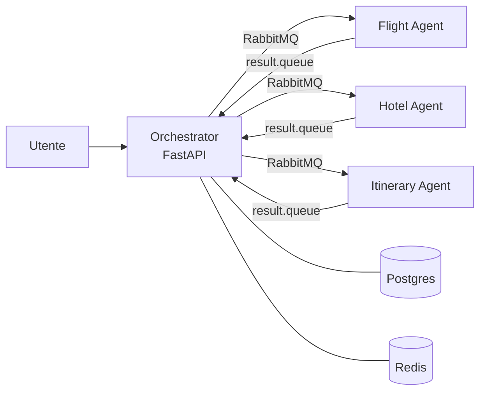

# Travel Planner Agents ✈️🏨🗺️

Un sistema **multi-agente** che pianifica viaggi: scrivi cosa vuoi fare ("5 giorni a Lisbona a marzo, budget medio, mi piacciono i musei") e un gruppo di agenti LLM si divide il lavoro per restituirti voli, hotel e cose da vedere.

Progetto universitario, in sviluppo. Consegna prevista: **10 dicembre 2026**.

## Come funziona

L'idea è simulare un'agenzia di viaggi in cui ogni "impiegato" è un agente specializzato:

| Agente | Cosa fa |
|---|---|
| **Orchestrator** | Riceve la richiesta, la divide in sotto-task, li manda agli altri agenti e alla fine scrive il report |
| **Flight Agent** | Cerca e confronta voli e treni |
| **Hotel Agent** | Cerca strutture in base alle preferenze |
| **Itinerary Agent** | Cerca attrazioni ed eventi nel luogo e nel periodo del viaggio |

Gli agenti sono microservizi separati e **non si chiamano direttamente**: comunicano tramite code **RabbitMQ**. Ognuno usa i propri strumenti tramite **server MCP**, che collegano le API reali di voli, hotel e punti di interesse.



I tre agenti specializzati lavorano **in parallelo**. L'orchestratore raccoglie i risultati (lo stato temporaneo sta su Redis), genera il report finale e lo salva su Postgres.

## Stack

- **Python 3.12** in un monorepo gestito con [uv](https://docs.astral.sh/uv/) (workspace)
- **deepagents** + **LangChain** per gli agenti, con qualsiasi modello che esponga un'API compatibile OpenAI
- **MCP** (Model Context Protocol) per i tool, con `langchain-mcp-adapters`
- **FastAPI** per l'API dell'orchestratore
- **RabbitMQ**, **PostgreSQL**, **Redis**
- **Docker / Docker Compose**, CI con **GitHub Actions**

## Struttura del repo

```
.
├── services/
│   ├── orchestrator-agent/   # API + coordinamento + report finale
│   ├── flight-agent/
│   ├── hotel-agent/
│   └── itinerary-agent/
├── libs/common/              # codice condiviso (contratti messaggi, client RabbitMQ, config)
├── mcp_servers/              # server MCP custom (solo dove non ne esiste già uno)
├── frontend/                 # (opzionale)
├── infra/                    # k8s / terraform / ansible (opzionali)
├── docs/ROADMAP.md           # obiettivi, componenti e piano di lavoro
└── docker-compose.yml
```

## Avvio rapido

### Prerequisiti

- [Docker](https://docs.docker.com/get-docker/) con Docker Compose
- [uv](https://docs.astral.sh/uv/getting-started/installation/)
- Una chiave API per un modello LLM compatibile con l'API OpenAI

### 1. Installare le dipendenze

```bash
git clone https://github.com/lorenzodidomenic/Travel-Planner-Agents.git
cd Travel-Planner-Agents
uv sync --all-packages
```

### 2. Configurare le variabili d'ambiente

Ogni servizio legge il proprio `.env`. Parti dal template:

```bash
for s in orchestrator-agent flight-agent hotel-agent itinerary-agent; do
  cp .env.example services/$s/.env
done
```

Poi compila almeno `MODEL_API_KEY` (e `MODEL_BASE_URL` se non usi l'endpoint di default).

### 3. Avviare l'infrastruttura

```bash
docker compose up -d
docker compose ps        # rabbitmq, postgres e redis devono risultare "healthy"
```

L'interfaccia di RabbitMQ è su http://localhost:15672.

### 4. Provare l'orchestratore

```bash
uv run --env-file services/orchestrator-agent/.env \
  uvicorn orchestrator_agent.api:app --reload
```

```bash
curl http://localhost:8000/health

curl -X POST http://localhost:8000/chat \
  -H "Content-Type: application/json" \
  -d '{"message": "Voglio andare a Lisbona dal 10 al 15 marzo"}'
```

> Per ora `/chat` chiama direttamente l'agente orchestratore, senza passare dagli altri agenti: serve solo per fare debug. Il flusso completo arriva con la milestone M1 (vedi sotto).

## Stato del progetto

Il piano completo è in [docs/ROADMAP.md](docs/ROADMAP.md). In breve:

- [ ] **Fase 0** – Infrastruttura (Docker Compose), README
- [ ] **M1** (22/11) – Un messaggio fa il giro completo orchestratore → agenti → orchestratore
- [ ] **M2** (29/11) – Ogni agente risponde usando API reali tramite MCP
- [ ] **M3** (04/12) – Dalla richiesta in linguaggio naturale al report completo salvato su database
- [ ] **Consegna** (10/12)

## Autore

**Lorenzo Didomenico** – studente universitario

Licenza: MIT
